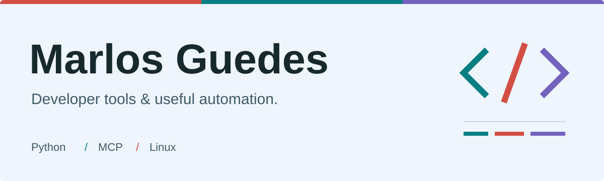
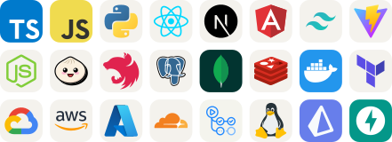

<picture>
  <source media="(prefers-color-scheme: dark)" srcset="./assets/banner-dark.svg">
  <source media="(prefers-color-scheme: light)" srcset="./assets/banner-light.svg">
  
</picture>

### Full-stack development, from interface to infrastructure

I'm Marlos, a developer based in **Sao Paulo, Brazil**. I work across web
applications, backend services, applied AI, and the integrations that connect
them to real business workflows.

Most of my work lives in **private repositories**. The public projects below
are a small part of my experience, which also spans business platforms,
data intelligence, reporting, and cloud delivery.

[LinkedIn](https://www.linkedin.com/in/marlos-do-carmo-guedes-366987250/)
&nbsp; / &nbsp;
[Explore my repositories](https://github.com/Marlos001?tab=repositories)

### Experience beyond public repositories

**Business platforms & integrations**
 Multi-tenant CRM, sales pipelines, inventory, financial workflows, and billing.
Messaging, financing, and fiscal integrations, with scoped permissions,
webhook handling, and real-time updates.

**Applied AI & data intelligence**
 Source discovery, data ingestion, LLM-assisted analysis, and background
processing. Connecting research workflows to reviewable outputs, with attention
to provenance, retries, and operational visibility.

**Reporting & document automation**
 PDF and spreadsheet exports, template-based documents, data reconciliation,
and evidence-linked reporting. Work on preserving source data and making
large reporting workflows more reliable.

**Product engineering & delivery**
 React workspaces, typed APIs, PostgreSQL migrations, automated tests, and
CI/CD. Hands-on work with containerized services, Google Cloud, Railway,
and debugging across frontend, backend, and infrastructure.

### Stack I work with

<picture>
  <source media="(prefers-color-scheme: dark)" srcset="./assets/stack-dark.svg">
  <source media="(prefers-color-scheme: light)" srcset="./assets/stack-light.svg">
  
</picture>

**Frontend:** TypeScript, React, React Router, Tailwind CSS, Vite.
 **Backend & data:** Node.js, Bun, Hono, Elysia, PostgreSQL, Drizzle, Redis.
 **Delivery & tooling:** Docker, GitHub Actions, Google Cloud, Railway,
Python, Playwright, Vitest, MCP, Linux.

### A few public projects

#### [Omarchy Computer MCP](https://github.com/Marlos001/omarchy-computer-mcp)

An experimental desktop-control bridge for MCP clients on Omarchy and Hyprland.
Screenshots, window focus, keyboard, and pointer input across native Wayland and
XWayland applications.
 Python &nbsp; / &nbsp; MCP &nbsp; / &nbsp; Linux

#### [PDF Automation](https://github.com/Marlos001/automationpdf)

Turn spreadsheet rows into individual PDFs, using built-in layouts or an existing
PDF template. Includes a command-line interface and a Streamlit app.
 Python &nbsp; / &nbsp; Streamlit &nbsp; / &nbsp; Docker

#### [CI/CD Metrics Lab](https://github.com/Marlos001/ponderada-metricas-cicd)

A practical experiment measuring GitHub Actions pipelines. Compares caching,
parallel jobs, and test suites, with scripts for collecting metrics and charts.
 Python &nbsp; / &nbsp; GitHub Actions &nbsp; / &nbsp; Testing

### Outside the main stack

I also tinker with **Omarchy, Hyprland, and developer tooling**, and explore
[Rust](https://github.com/Marlos001/zero2prod) and
[Flutter](https://github.com/Marlos001/Expenses-app-Flutter).

### Contributions, in motion

<picture>
  <source media="(prefers-color-scheme: dark)" srcset="./assets/contributions-dark.svg">
  <source media="(prefers-color-scheme: light)" srcset="./assets/contributions-light.svg">
  
</picture>

---

Artwork: <a href="https://github.com/tandpfun/skill-icons">Skill Icons</a> and <a href="https://github.com/Platane/snk">snk</a>.
